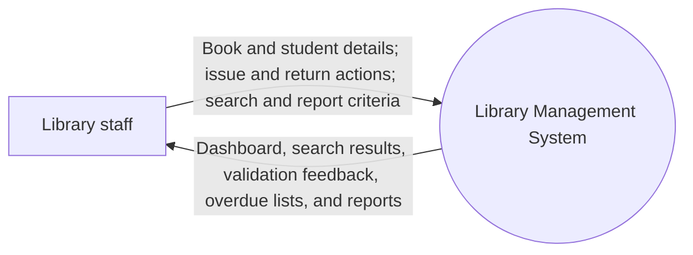
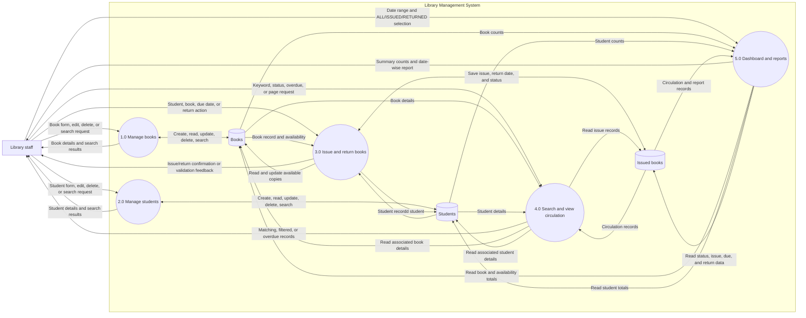

# Data Flow Diagrams

These diagrams summarize how a library staff member interacts with the Library Management System and how the application reads and writes its MySQL data. They are based on the current Spring MVC controllers, services, repositories, and JPA entities.

## Level 0: Context diagram

## Level 1: Main processes and data stores

## Process notes

1. **Manage books:** accepts book form actions and searches, then uses the book repository to persist or retrieve records. Book validation includes required title, author, and ISBN fields; ISBN is unique.
2. **Manage students:** accepts student form actions and searches. Student validation includes required name, roll number, and email; roll number and email are unique.
3. **Issue and return books:** issue requests require existing student and book records, available copies, and a valid due date. Issuing decrements available copies. Returning records the return date and `RETURNED` status, then increments available copies.
4. **Search and view circulation:** supports issued-book search/filter and overdue records. Overdue records are currently issued records whose due date is before the current date.
5. **Dashboard and reports:** dashboard figures are derived from the book, student, and circulation records. Date-wise reports accept a start date, end date, and `ALL`, `ISSUED`, or `RETURNED` type.

## Scope

The current project presents server-rendered web pages to a staff user. This diagram does not include authentication or authorization flows because none are represented in the reviewed project routes. Data store names correspond to the JPA entity tables documented in `DATABASE.md`.
