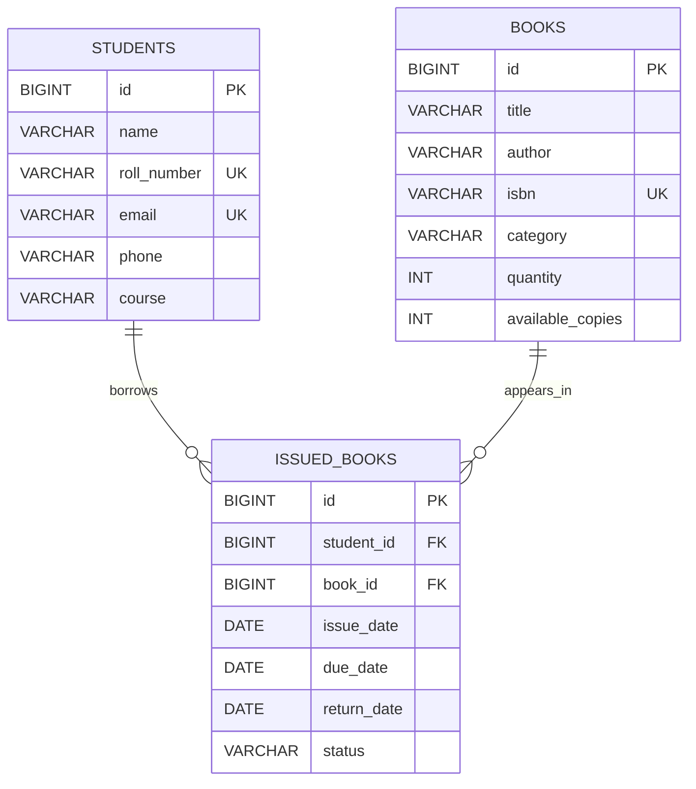

# Entity Relationship Diagram

The diagram below represents the entities and relationships used by the Library Management System. Each issue record belongs to one student and one book; either a student or book may be referenced by multiple issue records.

## Relationship details

- **Students to issued books:** one student can have zero or many issue records. Every issue record references one student through `student_id`.
- **Books to issued books:** one book can appear in zero or many issue records. Every issue record references one book through `book_id`.
- **Primary keys:** each entity uses an auto-generated `id`.
- **Unique fields:** `students.roll_number`, `students.email`, and `books.isbn` are unique in the entity mappings.

Column labels in the diagram use the database-style names inferred from Spring Boot's default Hibernate naming strategy. Database providers or ORM versions may render SQL types with additional precision or length details.

## Entity source

The diagram is derived from the JPA entities in `src/main/java/com/library/library/management/system/entity/`: `Student`, `Book`, and `IssuedBook`.
