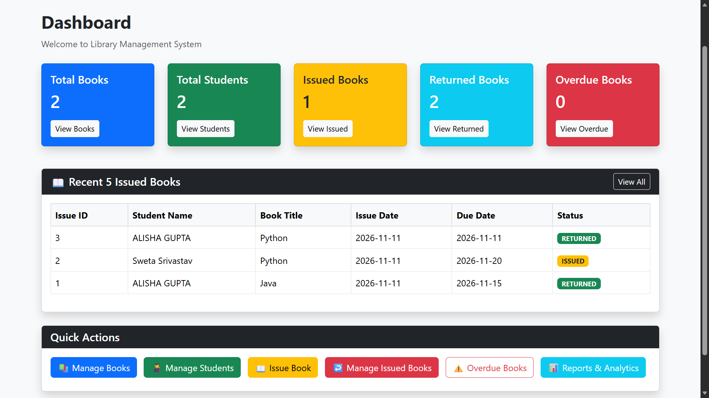
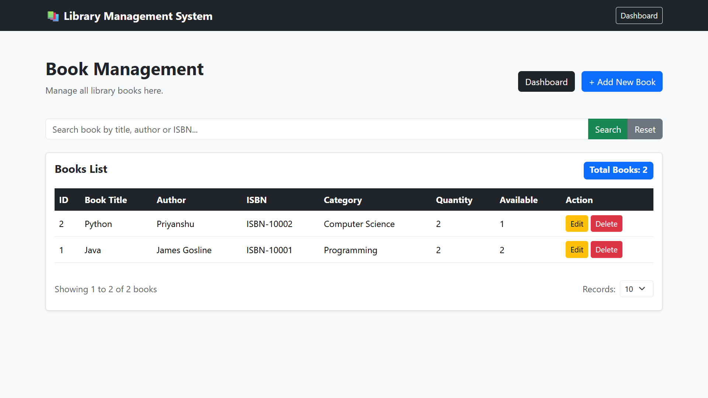
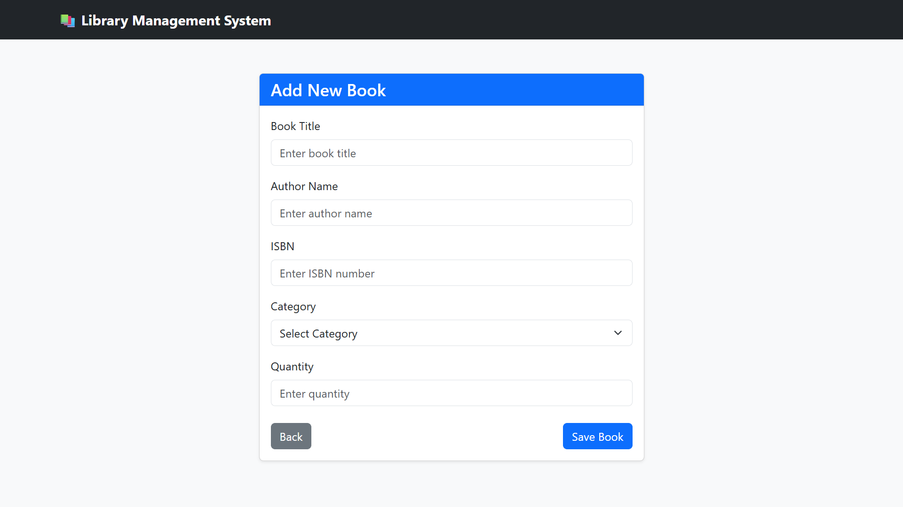
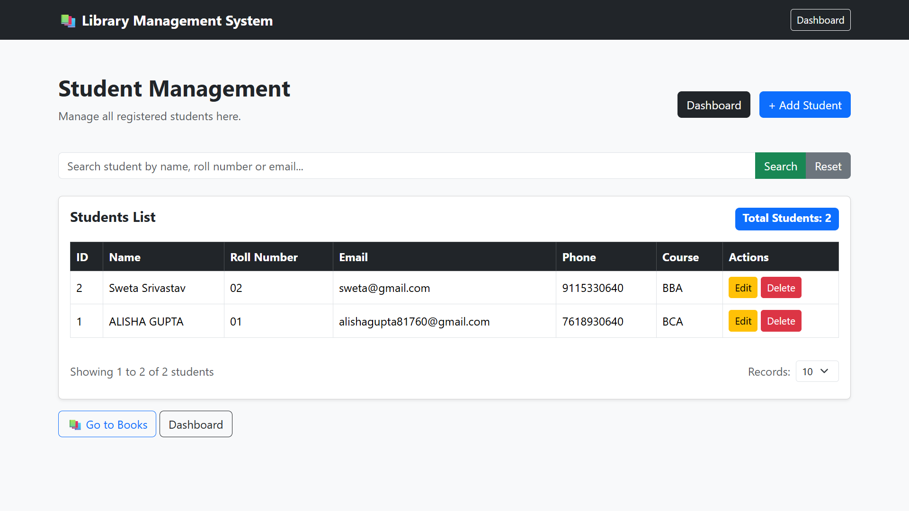
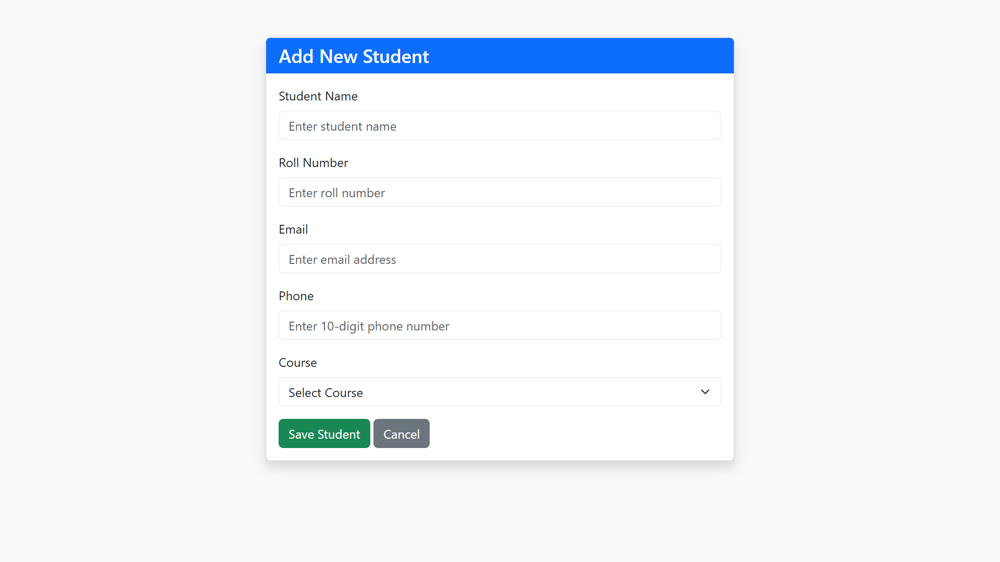
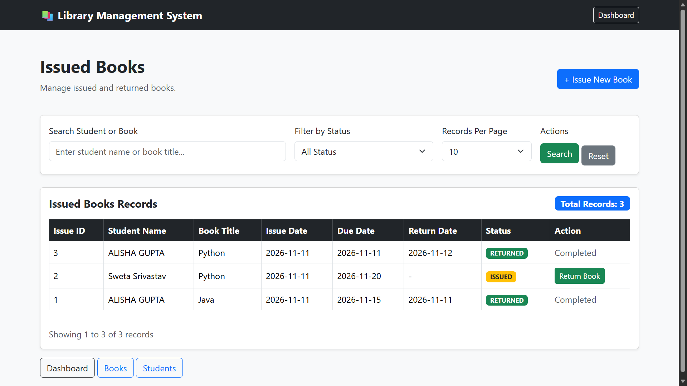
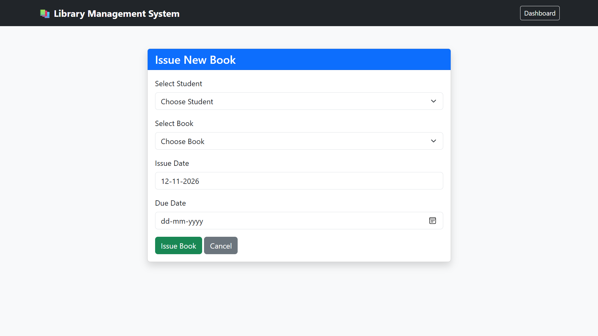
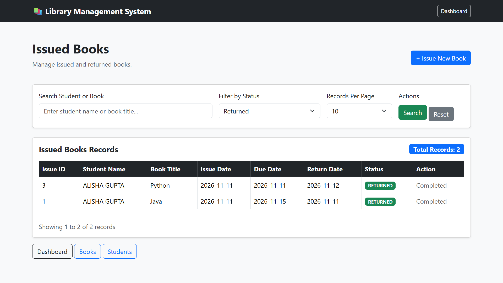
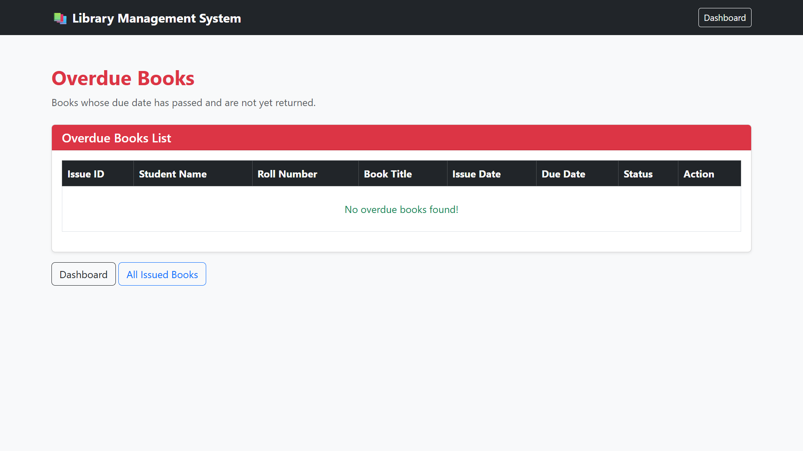

# Project Screenshots

The screenshots below show the Library Management System running with its current demonstration data. They are unaltered copies of the screenshots supplied for this project.

## Dashboard

## Books

## Students

## Issue and return management

## Overdue books

Two of the supplied images were exact duplicates and are represented once in this gallery. A Reports & Analytics screenshot was not included in the supplied images.
